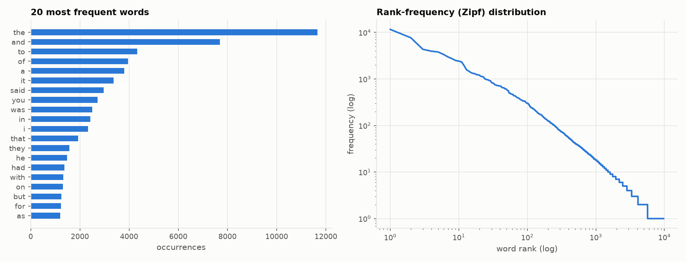
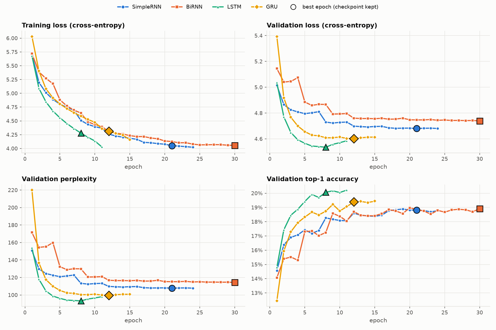
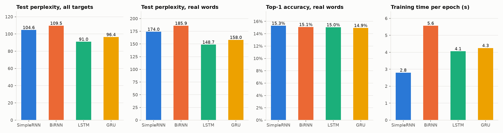
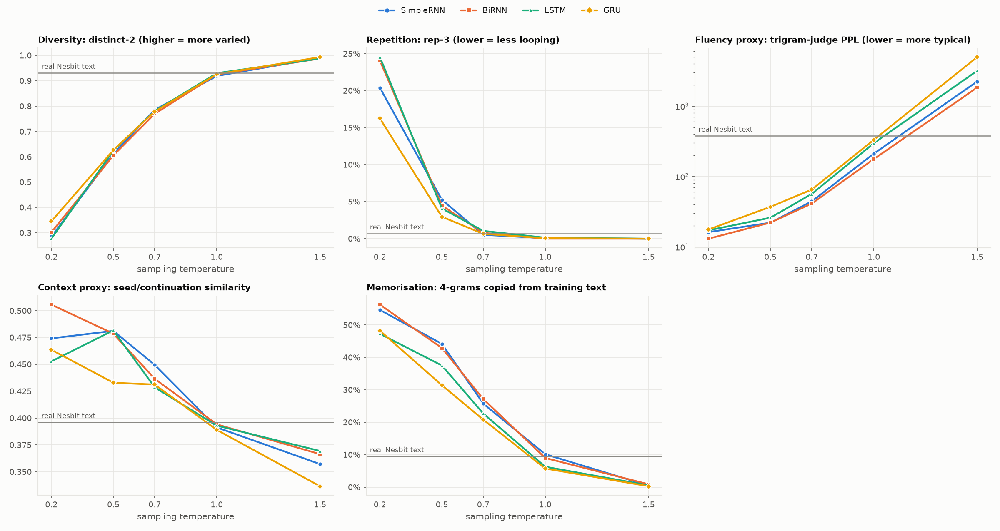

# Autoregressive Text Generation with Simple RNN, Bidirectional RNN, LSTM and GRU

**Foundations of Generative AI (ICT4403) – Assignment 2**  
**Kushal Bhagwan Bayaskar · Reg. No. 230911576**

A word-level autoregressive text-generation system trained on E. Nesbit's *Psammead* trilogy of children's
fantasy novels. Four recurrent architectures are trained with the same training protocol (data,
hyper-parameters, optimiser, seed and stopping rule) to predict the next word. Each model then generates text one
word at a time from the same seed sequences at five sampling temperatures. The models are compared on:

* held-out loss, perplexity and accuracy
* training time
* the coherence, diversity, contextual consistency and repetition of their generated text

---

## 1. Problem statement and objective

Given the previous *n* words of a text, predict the next word, w<sub>t</sub> ~ P(w<sub>t</sub> | w<sub>t-n</sub>, …, w<sub>t-1</sub>).
Applied repeatedly, with each sampled word fed back as input, this next-word model becomes a text generator.

**Objectives**

1. Prepare a real text corpus and turn it into input → target sequences for autoregressive modelling.
2. Implement and train **Simple RNN, Bidirectional RNN, LSTM and GRU** next-word models under comparable
   experimental conditions.
3. Evaluate them quantitatively (loss, perplexity, accuracy, training time) and qualitatively (coherence,
   diversity, contextual consistency and repetition of the generated text).
4. Generate text from the same seeds at **five sampling temperatures (0.2, 0.5, 0.7, 1.0, 1.5)**, analyse how
   temperature affects the text, and identify the most effective model for this dataset.

---

## 2. Dataset

| | |
|---|---|
| **Name** | E. Nesbit's *Psammead* trilogy: *Five Children and It*, *The Phoenix and the Carpet*, *The Story of the Amulet* |
| **Source** | Project Gutenberg eBooks [#778](https://www.gutenberg.org/ebooks/778), [#836](https://www.gutenberg.org/ebooks/836), [#837](https://www.gutenberg.org/ebooks/837) |
| **Plain-text files used** | `https://www.gutenberg.org/cache/epub/<id>/pg<id>.txt`, with copies in [`data/`](data/) |
| **Licence** | Public domain (Project Gutenberg) |

| Book | Gutenberg page | Tokens after cleaning |
|---|---|---|
| *Five Children and It (1902)* | <https://www.gutenberg.org/ebooks/778> | 61,281 |
| *The Phoenix and the Carpet (1904)* | <https://www.gutenberg.org/ebooks/836> | 71,883 |
| *The Story of the Amulet (1906)* | <https://www.gutenberg.org/ebooks/837> | 80,424 |

**Why this dataset**
* **Enough text:** about 185k words, enough for word-level recurrent models while still training in minutes on a
  laptop GPU.
* **One author, recurring characters:** Cyril, Anthea, Robert, Jane, the baby "the Lamb", the sand-fairy
  Psammead and the Phoenix appear throughout. The style is consistent, so it is easier to judge whether generated
  text "sounds right".
* **A lot of dialogue**, written in Edwardian English.
* **Rarely used for this exercise,** compared with corpora such as Shakespeare or Sherlock Holmes.

### 2.1 Characteristics

| Property (after cleaning) | Value |
|---|---|
| Tokens (words + punctuation) | 213,588 |
| Word tokens / punctuation tokens | 185,308 / 28,280 |
| Unique words (types) | 9,774 |
| Words occurring only once (hapax legomena) | 4,104 (42% of types) |
| Type-token ratio | 0.053 |
| Sentences / mean sentence length | 12,955 / 16.5 tokens |
| Model vocabulary | 4,943 entries: `<unk>` + 4,942 tokens seen ≥ 2× in the training split, covering 97.8% of training tokens |
| `<unk>` rate, train / validation / test | 2.2% / 5.3% / 4.9% |



Word frequencies follow Zipf's law. *the* alone is 6.3% of all words, and *said* is the 7th most frequent word,
which reflects how much of the text is dialogue. Like any book-length corpus this is a small language-modelling
task: models can learn local syntax, character names and stock phrases, but not plot structure.

### 2.2 Pre-processing ([`src/data.py`](src/data.py))

1. **Strip non-story text.**
   * Removed: the Project Gutenberg licence header and footer, title pages, dedications and tables of contents.
     Each book starts at its first real chapter heading.
   * Also removed: chapter headings (`CHAPTER 1`, `CHAPTER 1. THE EGG`, `CHAPTER I.`) with their all-capital
     titles, `[Illustration]` markers, and Gutenberg end notes.
2. **Normalise characters.** Curly quotes become straight quotes, dashes become spaces, `_italic_` markers are
   removed, and accented letters are converted to ASCII.
3. **Lower-case and tokenise.**
   * The text is split into words, numbers and the sentence punctuation `. , ! ? ; :`.
   * Internal apostrophes are kept, as in *don't* and *anthea's*.
   * Punctuation is kept as tokens so the models learn sentence boundaries.
   * Quotation marks are dropped, because unbalanced quotes make generated text hard to read.
4. **Split each book contiguously into 80% train, 10% validation and 10% test,** then join the parts.
   * Every split therefore contains text from all three books.
   * Because the split is contiguous rather than a random split of windows, no overlapping window can leak test
     text into training.
5. **Build the vocabulary from the training split only.** Words seen fewer than 2 times become `<unk>`.

### 2.3 Input → target sequences for autoregressive modelling

A sliding window (stride 1) over each split produces pairs of **30 context words → the next word**:

```
input  (30 ids): white house with a green garden and an orchard beyond , and mother said , here we are !
                 how white the house is , said robert . and look
target (1 id)  : at
```

| Split | Tokens | Input–target pairs |
|---|---|---|
| Train | 170,869 | 170,839 |
| Validation | 21,358 | 21,328 |
| Test | 21,361 | 21,331 |

---

## 3. Models ([`src/models.py`](src/models.py))

All four models share the same skeleton and hyper-parameters. **Only the recurrent cell differs.**

```
word ids (≤ 30) → Embedding(4943, 128) → Dropout(0.3) → 2-layer recurrent encoder (hidden 256)
                → final hidden state of the top layer → Dropout(0.3) → Linear(→ 4943) → softmax over next word
```

| Model | Recurrent encoder | How it works | Parameters |
|---|---|---|---|
| **SimpleRNN** | 2 × vanilla tanh RNN | h<sub>t</sub> = tanh(W x<sub>t</sub> + U h<sub>t-1</sub> + b). Simplest recurrence; prone to vanishing gradients over long spans. | 2,133,455 |
| **BiRNN** | 2 × bidirectional vanilla RNN | One RNN reads the context left→right and a second reads it right→left; their final states are concatenated (512-d). It only sees the *context window*, so no future information leaks in and it remains a valid next-word generator. | 3,760,335 |
| **LSTM** | 2 × LSTM | Adds a cell state and input/forget/output gates, so information and gradients can flow over many steps. | 2,824,655 |
| **GRU** | 2 × GRU | Gated unit with update and reset gates; lighter than an LSTM (3 gates' worth of weights instead of 4). | 2,594,255 |

### Shared training protocol ([`src/config.py`](src/config.py))

| Setting | Value |
|---|---|
| Context length | 30 words for evaluation. In training, half of the batches keep only the last 5–29 words (random length per batch), so the models also learn to predict from short contexts like the 7–15-word generation seeds. |
| Embedding / hidden size / layers / dropout | 128 / 256 / 2 / 0.3 |
| Loss | Cross-entropy on the next word |
| Optimiser | Adam, learning rate 2e-3, gradient-norm clipping 1.0 |
| LR schedule | ReduceLROnPlateau (×0.5 after 1 epoch without validation improvement) |
| Batch size | 256 |
| Stopping rule | Max 30 epochs; early stopping with patience 3 on validation loss; the best-validation checkpoint is kept |
| Random seed | 42 for all models (same initialisation seed, batch order and context-length draws); cuDNN deterministic mode |
| Hardware / software | NVIDIA RTX 4060 Laptop GPU; Python 3.13.7, PyTorch 2.13.0 (CUDA 12.6), NumPy 2.5.2, Matplotlib 3.11.1 |

### Limitations of the comparison

The models share one training protocol, but the comparison is not perfectly controlled:

* **Not parameter-matched.** The models range from 2.13 M (SimpleRNN) to 3.76 M (BiRNN) parameters. The BiRNN's
  512-d feature vector makes its output layer about 2.5 M parameters, against about 1.3 M for the others.
  Differences between models therefore mix the effect of the recurrent cell with the effect of model size.
* **Different training lengths.** Early stopping gives 11–30 epochs in the main run.
  * The vanilla RNNs converge much more slowly than the gated ones.
  * In the main run the BiRNN reached the 30-epoch cap. Its validation perplexity improved only from 115.3
    (epoch 20) to 114.3 (epoch 30), so it was effectively converged.
  * In the robustness runs (§5.2), several SimpleRNN and BiRNN runs also had their best epoch at or next to the cap.
    Their results may therefore be slightly pessimistic.
* **The "Bidirectional RNN" is a bidirectional *vanilla* (tanh) RNN,** the bidirectional counterpart of the
  SimpleRNN. A bidirectional LSTM or GRU was not tested.
* **One data split and one hyper-parameter setting.** No hyper-parameters were tuned for any model.

---

## 4. Execution steps and dependencies

**Dependencies:** Python ≥ 3.10, PyTorch ≥ 2.1, NumPy, Matplotlib (see [`requirements.txt`](requirements.txt); the
exact versions used are listed in §3). A CUDA GPU is used automatically if available. Everything also runs on CPU,
just more slowly.

```bash
git clone https://github.com/kingsofoly/FGAI_Assignment.git
cd FGAI_Assignment
pip install -r requirements.txt        # for GPU builds of PyTorch see https://pytorch.org/get-started/locally/

python train.py                  # pre-process data, train all 4 models -> models/*.pt, results/training_*, plots/
python evaluate.py               # test metrics, generation at 5 temperatures, text metrics -> results/*.md|json, plots/
python supplementary_analysis.py # metrics by target type + short-context check (saved checkpoints only)
python robustness.py             # (optional) retrain each model with 3 more seeds, report mean ± std
python generate.py --seed "the psammead looked at the children and" --model LSTM --temperature 0.5 0.7
```

* The three book files are already in `data/`.
* Running times on the RTX 4060:
  * `train.py`: about 6 minutes
  * `evaluate.py`: under a minute
  * `supplementary_analysis.py`: a few seconds
  * `robustness.py`: about 20 minutes
* The trained checkpoints are included in `models/`, so `evaluate.py`, `supplementary_analysis.py` and
  `generate.py` can be run without retraining.

### Repository structure

```
├── README.md
├── requirements.txt
├── data/                           # the three Project Gutenberg books (source links above)
├── src/
│   ├── config.py                   # paths, dataset links, all shared hyper-parameters, seeds, temperatures
│   ├── data.py                     # cleaning, tokenisation, vocabulary, splits, sliding windows, statistics
│   ├── models.py                   # SimpleRNN / BiRNN / LSTM / GRU next-word models
│   ├── generation.py               # autoregressive temperature sampling
│   ├── text_metrics.py             # distinct-n, rep-n, trigram fluency judge, LSA context score, copy rate
│   └── plots.py                    # all figures
├── train.py  evaluate.py  supplementary_analysis.py  robustness.py  generate.py
├── models/                         # trained checkpoints (best validation epoch) + vocab.json
├── results/                        # metrics (.md/.json), training history, logs, generated samples
└── plots/                          # dataset, training-curve, test-metric and temperature figures
```

---

## 5. Results

### 5.1 Training behaviour



| Model | Best epoch / epochs run | Best val. perplexity | Time per epoch | Total training time |
|---|---|---|---|---|
| SimpleRNN | 21 / 24 | 107.8 | 2.8 s | 67 s |
| BiRNN | 30 / 30 (cap) | 114.3 | 5.6 s | 167 s |
| LSTM | 8 / 11 | 93.2 | 4.1 s | 45 s |
| GRU | 12 / 15 | 99.7 | 4.3 s | 64 s |

(Full per-epoch log: [`results/training_log.txt`](results/training_log.txt), [`results/training_history.json`](results/training_history.json).)

* **LSTM** reaches the lowest validation loss, at epoch 8. After that it overfits: training loss keeps falling
  while validation loss rises.
* **GRU** is second, with its best epoch at 12.
* **SimpleRNN** learns more slowly. It needs 21 epochs and several learning-rate reductions to reach 107.8.
* **BiRNN** is last and improves only marginally over its final 10 epochs (§3).
* **Generalisation.** When the models reach a similar training loss (≈4.36–4.40), validation loss is 4.54 (LSTM),
  4.60 (GRU), 4.73 (SimpleRNN) and 4.80 (BiRNN). This comparison is approximate, because training loss is logged
  with dropout active and includes the shorter-context batches.

**How training time was measured.**
* Wall-clock time of the training passes only, excluding validation, measured with `time.perf_counter()` and CUDA
  synchronisation.
* NVIDIA RTX 4060 Laptop GPU, one run per model, with the models trained one after another.
* Total time depends on how many epochs early stopping allowed, so time per epoch is the more comparable figure.
* These are **training** times. Generation (inference) speed was not measured and is not compared.

### 5.2 Quantitative test-set evaluation (21,331 unseen windows)

| Model | Params | Test loss | Perplexity (all targets) | Perplexity (real words) | Top-1 (all) | Top-1 (real words) | Top-5 (all) | Top-5 (real words) |
|---|---|---|---|---|---|---|---|---|
| SimpleRNN | 2.13 M | 4.650 | 104.6 | 174.0 | 18.9% | 15.3% | 41.6% | 33.0% |
| BiRNN | 3.76 M | 4.696 | 109.5 | 185.9 | 19.1% | 15.1% | 41.8% | 33.2% |
| LSTM | 2.82 M | 4.511 | 91.0 | 148.7 | 19.8% | 15.0% | 42.8% | 34.2% |
| GRU | 2.59 M | 4.568 | 96.4 | 158.0 | 19.4% | 14.9% | 41.7% | 33.0% |

*Source: [`results/test_metrics.json`](results/test_metrics.json).*
* Perplexity = exp(cross-entropy). Lower means the model is less "surprised" by real unseen text.
* "All targets" counts every test target, including punctuation tokens and the `<unk>` placeholder.
* "Real words" excludes punctuation and `<unk>` targets.



#### Overall versus real-word metrics

The test targets are:
* real words: 81.2%
* punctuation: 14.0%
* `<unk>`, the single placeholder for every rare word: 4.9%

[`supplementary_analysis.py`](supplementary_analysis.py) splits top-1 accuracy by target type, using the saved
checkpoints only ([`results/supplementary_analysis.md`](results/supplementary_analysis.md)):

| Model | Top-1, real words | Top-1, punctuation | Top-1, `<unk>` | Top-1, all targets |
|---|---|---|---|---|
| SimpleRNN | 15.29% | 40.51% | 18.05% | 18.95% |
| BiRNN | 15.08% | 41.95% | 19.88% | 19.07% |
| LSTM | 15.04% | 44.00% | 29.83% | 19.81% |
| GRU | 14.93% | 42.76% | 26.54% | 19.38% |

* **Perplexity (main run).** The LSTM is lowest on all targets (91.0) and on real words (148.7), followed by the
  GRU (96.4 / 158.0), the SimpleRNN (104.6 / 174.0) and the BiRNN (109.5 / 185.9). The robustness runs below show
  that the LSTM–GRU gap is smaller and less consistent than this single run suggests.
* **Top-1 accuracy on real words shows no meaningful difference:** 14.9–15.3%, with the SimpleRNN marginally
  highest. The LSTM is *not* better at picking the single most likely real word.
* **The LSTM's higher overall top-1 accuracy** (19.8% vs 18.9–19.4%) comes from punctuation and `<unk>` targets.
  Weighting each target type by its share of the test set, its 0.86-point lead over the SimpleRNN breaks down as
  * about +0.49 from punctuation
  * about +0.57 from `<unk>`
  * −0.20 from real words
* **Top-5 accuracy on real words:** the LSTM has the correct word among its five best guesses more often (34.2%
  vs 33.0–33.2%). This is consistent with its lower perplexity: it ranks and weights the plausible candidates
  better, even though its single top guess is not more often right.
* **Which model looks best therefore depends on the metric:**
  * perplexity and real-word top-5: LSTM in this run
  * real-word top-1: no clear winner
  * overall top-1: LSTM, but only because of punctuation and `<unk>`

#### Short contexts

The generation seeds are 7–15 words long, shorter than the 30-word evaluation window. Test perplexity when the
models see only the last 12 or 5 words:

| Model | 30 words (as evaluated) | Last 12 words | Last 5 words |
|---|---|---|---|
| SimpleRNN | 104.6 | 104.8 (+0.2%) | 107.2 (+2.5%) |
| BiRNN | 109.5 | 109.6 (+0.1%) | 112.9 (+3.1%) |
| LSTM | 91.0 | 91.4 (+0.5%) | 94.0 (+3.3%) |
| GRU | 96.4 | 94.3 (-2.2%) | 98.2 (+1.9%) |

* Because training included shorter contexts, cutting the context to the last 12 words changes perplexity by only
  −2.2% to +0.5%. With 5 words the change is +1.9% to +3.3%.
* So the short seeds are not a significant handicap for any model.
* The GRU is slightly *better* with 12 words than with 30. A possible reading, not tested further, is that it makes
  little use of the older part of the window.

#### Robustness check

Each model was retrained 3 more times with different seeds ([`results/robustness.md`](results/robustness.md)).
These runs used the same data split and hyper-parameters; their checkpoints were not saved.

| Model | Test perplexity per run (seeds 1, 2, 3) | Mean ± sample std | Real-word perplexity, mean ± std | Real-word top-1, mean ± std |
|---|---|---|---|---|
| SimpleRNN | 105.5, 107.2, 105.5 | 106.1 ± 1.0 | 178.3 ± 1.7 | 15.1% ± 0.2% |
| BiRNN | 114.3, 113.4, 116.5 | 114.8 ± 1.6 | 196.7 ± 3.1 | 15.0% ± 0.1% |
| LSTM | 93.0, 92.8, 97.3 | 94.4 ± 2.5 | 155.5 ± 4.0 | 14.7% ± 0.2% |
| GRU | 96.8, 97.6, 96.9 | 97.1 ± 0.5 | 159.6 ± 1.5 | 14.6% ± 0.5% |

These runs are **preliminary evidence** about consistency across initialisations. Counting the main run, there
are four runs per model:

| Model | Test perplexity range (4 runs) |
|---|---|
| LSTM | 91.0–97.3 |
| GRU | 96.4–97.6 |
| SimpleRNN | 104.6–107.2 |
| BiRNN | 109.5–116.5 |

* **Gated versus vanilla RNNs (the clearest result).** In every run, both gated models had lower test perplexity
  than both vanilla models, and the SimpleRNN beat the BiRNN.
* **LSTM versus GRU (much closer).**
  * The LSTM had the lower overall perplexity in 3 of the 4 runs. With seed 3 the GRU was slightly lower (96.9 vs
    97.3).
  * On real-word perplexity the LSTM was lowest in all 4 runs, but its margin over the GRU ranged from 0.9 to 9.4
    points.
  * The LSTM's results also varied more between runs (91.0–97.3, against 96.4–97.6 for the GRU).
* **Real-word top-1 accuracy** stayed within 14.1–15.3% for every model and run; no model was consistently best.
* **Convergence.**
  * The LSTM's best epoch was 8 in every run, and the GRU's 7–14.
  * The vanilla models needed far longer: SimpleRNN 21–30, BiRNN 29–30.
  * In several vanilla-RNN runs the best epoch was the last one allowed (30), so these models might improve
    slightly with a longer budget. In the main BiRNN run, the gain over the last 10 epochs was under 1%.
* **Caveats.**
  * The ± values are sample standard deviations (ddof = 1) over three runs and are descriptive only.
  * No significance test or confidence interval was computed.
  * All runs share one data split and one hyper-parameter setting.

### 5.3 Generated text samples

* Each model generated 40 words after each of 4 seeds, with 10 samples per seed at every temperature: 200 samples
  per model and 800 in total. All of them are in [`results/generated_samples.md`](results/generated_samples.md)
  and [`results/generated_samples.json`](results/generated_samples.json).
* All models use **the same random-number stream**, so differences between models come from the models and not from
  luck. A side-effect is that at higher temperatures different models sometimes produce the same words, wherever
  their predicted distributions agree.
* The continuations below are copied verbatim from `results/generated_samples.md` (the first of the 10 samples).

**Seed: "*The phoenix spread its golden wings and said*" (temperature 0.5)**

| Model | Continuation |
|---|---|
| SimpleRNN | : I don't know how you know how you have done, said anthea. Oh, yes! Said cyril, and the others went to the top of the tower. The children were a little black moustache |
| BiRNN | : I don't see how, said anthea. What is the matter of the story, and I am sure you was a beast and cake, said anthea. I don't know what you're a dream, said |
| LSTM | it was a difficult still, so they could not go into the children. Oh, said cyril. I wish you are! And as you all are. I expect it was, said cyril, and |
| GRU | : I don't see the magic, said the bird, and the children went back with a basket. I wish you are the children. You know, said anthea. I wish you were not going to |

**Seed: "*I wish, said anthea, that*" (temperature 0.7)**

| Model | Continuation |
|---|---|
| SimpleRNN | he was right. You know that we have a beautiful bath of the charm, I really wanted to be in to tell the day. It was in the pantry room. The children sat down to the |
| BiRNN | he was really. You know that we have a poor idea of years ago, I really wanted to be in your country. The learned gentleman came in the pantry, and the periwinkles were, and had |
| LSTM | he was really. You know that we have a beautiful one of the charm, I am sure they got in the stable. The learned gentleman came in the pantry, and the children could never be so |
| GRU | he was really. The baker's gentleman had his born. He was very much, I really wish he was going to tell the others. It was in the pantry wonderful part of the room, because they |

### 5.4 Qualitative characteristics and how they were approximated

Each qualitative property is approximated by an automatic **proxy measure** computed over the 40 samples per model
and temperature ([`src/text_metrics.py`](src/text_metrics.py)). The same measures are computed on **real passages
from the unseen test split** as a reference.

| Property | Proxy measure | Interpretation |
|---|---|---|
| **Diversity** | **Distinct-2**: unique bigrams ÷ total, across the 10 samples of a seed | Higher means more varied wording and samples |
| **Repetition** | **Rep-3**: share of trigrams in a sample that repeat an earlier trigram in the same sample | Higher means looping |
| **Coherence / fluency** | **Judge PPL**: perplexity of the continuation under a separate interpolated trigram LM fitted on the training split | Lower means word sequences more typical of the training text; values far above the real-text level indicate broken word order |
| **Contextual consistency** | **Context sim**: cosine similarity between the seed and the continuation in an LSA word space (PPMI + SVD, built from the training split) | Real continuations score 0.396; an unrelated real passage scores 0.365 |
| **Memorisation** | **Copy-4**: share of generated 4-grams that occur verbatim in the training text | Real unseen text: 9.5%. Much higher means the model is reciting training phrases. |

**These metrics are proxies, not measurements of human-perceived quality.** No human evaluation was carried out.
Their limitations:

* **Judge PPL** comes from a trigram model trained on the same text the networks learned from.
  * It therefore rewards reproducing training phrases, so it rises and falls with copy-4.
  * The real reference passages contain rare words outside the models' vocabulary (test `<unk>` rate 4.9%),
    which pushes the reference value up.
  * Model text scoring *lower* than real text means more typical, formulaic word sequences, not better writing.
* **Distinct-n** is not exactly like-for-like against the reference. The 10 model samples in a group share the same
  seed, while the 10 reference passages come from different places in the test split.
* **Context sim separates related from unrelated text only weakly:** 0.396 against 0.365.
  * Model text at T ≤ 0.7 scores *higher* than real continuations (0.43–0.51), which suggests the measure
    rewards repeating the seed's topical words rather than measuring consistency.
  * It is not used to rank the models.
* **Copy-4** counts punctuation tokens, so common phrases such as ", said anthea ." count as copying.
* **Statistical basis.** Each value averages 40 continuations from only 4 seeds, and no confidence intervals were
  computed.

These measures show the **large, consistent effects of temperature** reliably. The **small differences between
models at a fixed temperature** should not be read as proof that one model writes better text.

---

## 6. Sampling-temperature analysis

At each step the next word is sampled from softmax(logits / T). T < 1 sharpens the distribution towards the
most likely words; T > 1 flattens it towards rare words.



| Model | T | Distinct-2 ↑ | Rep-3 ↓ | Judge PPL | Context sim | Copy-4 |
|---|---|---|---|---|---|---|
| SimpleRNN | 0.2 | 0.285 | 20.4% | 16.3 | 0.474 | 54.7% |
| SimpleRNN | 0.5 | 0.612 | 5.3% | 22.1 | 0.481 | 44.2% |
| SimpleRNN | 0.7 | 0.785 | 0.5% | 44.5 | 0.450 | 25.7% |
| SimpleRNN | 1.0 | 0.919 | 0.1% | 211.9 | 0.391 | 10.1% |
| SimpleRNN | 1.5 | 0.990 | 0.0% | 2243.8 | 0.357 | 0.5% |
| BiRNN | 0.2 | 0.302 | 24.1% | 13.1 | 0.506 | 56.3% |
| BiRNN | 0.5 | 0.606 | 4.5% | 22.2 | 0.479 | 42.9% |
| BiRNN | 0.7 | 0.770 | 0.8% | 41.3 | 0.437 | 27.2% |
| BiRNN | 1.0 | 0.925 | 0.0% | 177.3 | 0.394 | 9.0% |
| BiRNN | 1.5 | 0.988 | 0.0% | 1841.7 | 0.366 | 0.9% |
| LSTM | 0.2 | 0.277 | 24.5% | 17.2 | 0.453 | 47.3% |
| LSTM | 0.5 | 0.626 | 4.1% | 26.1 | 0.482 | 37.5% |
| LSTM | 0.7 | 0.781 | 1.1% | 56.7 | 0.429 | 22.7% |
| LSTM | 1.0 | 0.930 | 0.1% | 298.2 | 0.393 | 6.3% |
| LSTM | 1.5 | 0.988 | 0.0% | 3182.2 | 0.369 | 0.5% |
| GRU | 0.2 | 0.346 | 16.2% | 17.7 | 0.464 | 48.2% |
| GRU | 0.5 | 0.627 | 3.0% | 37.1 | 0.433 | 31.4% |
| GRU | 0.7 | 0.779 | 0.7% | 65.4 | 0.431 | 20.8% |
| GRU | 1.0 | 0.926 | 0.1% | 332.7 | 0.389 | 5.7% |
| GRU | 1.5 | 0.994 | 0.0% | 4973.9 | 0.337 | 0.3% |
| *Real Nesbit text (test split)* | – | *0.930* | *0.7%* | *378.4* | *0.396* | *9.5%* |

**One seed, one model (LSTM), five temperatures:** "*When they spread out the magic carpet on the nursery floor,* …"

| T | LSTM continuation |
|---|---|
| 0.2 | and the children were very sleepy and white. The children were not very much. The children had been a very long man, and the children were not very much. The children were not very much, |
| 0.5 | and the sun would not buy a great idea of the day, and the children were only a interesting in the air. At last they could not help the other moment. The children had never seen the |
| 0.7 | for the most of the other dead children had been gone in the evening, because there was a caused of high and busy over the colour the hut and the others and the children were found the little sea |
| 1.0 | and cyril did said if I am most frightfully monkey to go, and you'll get the passage, for on its proper bag like a water. You can be some that it was? Said jane, as |
| 1.5 | whispered ike on appreciation it asleep giving jane. You can do soldiers in turns really cheerful. The others we wished it if he never may up yourself. Seeing cats became parted these trees stall like, and |

### What temperature does

Each point below separates *measured* proxy values (from the table above) from *observed* features of the saved
samples. The observations are the author's reading, not measurements.

* **T = 0.2 (near-greedy): repetitive and memorised.**
  * *Measured:* rep-3 16–25%, distinct-2 only 0.28–0.35, and 47–56% of 4-grams copied from the training text.
    Judge PPL is 13–18, low because the text consists of very common training phrases.
  * *Observed:* loops such as "*The children were wiser to be trusted. The children were wiser to be trusted.*"
    (SimpleRNN, seed 1), and reused stock sentences such as "*And the children were left alone.*" (SimpleRNN,
    seed 2), which occurs in the training text.
* **T = 0.5: formulaic but readable.**
  * *Measured:* rep-3 3.0–5.3%, distinct-2 0.61–0.63, copy-4 still 31–44%.
  * *Observed:* dialogue uses the right character names and speech tags ("*I don't see how, said anthea.*" —
    BiRNN, seed 2). Short clauses are usually grammatical, but meaning drifts after a sentence or two.
* **T = 0.7: the best balance on the proxy metrics.**
  * *Measured:* rep-3 0.5–1.1%, distinct-2 0.77–0.79, and copy-4 21–27%, closer to real text's 9.5%. Judge PPL
    (41–65) is still well below the real-text value (378); given the judge's bias this means typical word
    sequences, not better-than-human fluency.
  * *Observed:* more varied sentences that stay in the books' world ("*The learned gentleman came in the
    pantry*"), but long-range meaning still drifts.
* **T = 1.0: the unmodified model distribution.**
  * *Measured:* distinct-2 0.92–0.93 against 0.93 for real text, and rep-3 ≤ 0.1% against 0.7%. Judge PPL rises to
    177–333.
  * *Observed:* grammar breaks down more often ("*melted would be warmer comfortable*" — LSTM, seed 4).
* **T = 1.5: largely incoherent.**
  * *Measured:* distinct-2 0.99, and judge PPL 1,842–4,974, 5–13× the real-text value. Context similarity falls to
    0.34–0.37, below real text and around the unrelated-passage level.
  * *Observed:* word salad ("*thank shall you stolen we sister yet a antiquity*" — LSTM, seed 2).

**Trade-off.** For every model, raising the temperature increases diversity and decreases repetition and
memorisation. Above about 0.7, judge perplexity rises steeply and the samples visibly lose grammatical coherence.
Judged from the proxy metrics together with the samples, the most useful range in this experiment is
**T ≈ 0.5–0.7**: 0.5 for safer, more formulaic text and 0.7 for more variety.

Temperature changes the proxy metrics far more than the choice of architecture does. Distinct-2 spans 0.28–0.99
across temperatures, but differs by at most 0.07 between models at the same temperature.

---

## 7. Model comparison and evaluation

| Criterion | SimpleRNN | BiRNN | LSTM | GRU |
|---|---|---|---|---|
| Test perplexity, all targets (main run / mean of 3 extra runs) | 104.6 / 106.1 | 109.5 / 114.8 | 91.0 / 94.4 | 96.4 / 97.1 |
| Test perplexity, real words (main run / mean of 3 extra runs) | 174.0 / 178.3 | 185.9 / 196.7 | 148.7 / 155.5 | 158.0 / 159.6 |
| Top-1 real words (main run) | 15.3% | 15.1% | 15.0% | 14.9% |
| Top-5 real words (main run) | 33.0% | 33.2% | 34.2% | 33.0% |
| Top-1 all targets (main run) | 18.9% | 19.1% | 19.8% | 19.4% |
| Training time per epoch / total (main run) | 2.8 s / 67 s | 5.6 s / 167 s | 4.1 s / 45 s | 4.3 s / 64 s |
| Rep-3 at T = 0.2 (proxy) | 20.4% | 24.1% | 24.5% | 16.2% |
| Copy-4 at T = 0.7 (proxy) | 25.7% | 27.2% | 22.7% | 20.8% |

**Which model is "best" depends on the metric:**
* **Perplexity.**
  * Gated models beat vanilla ones in every run.
  * Between the gated models, the LSTM was lower in 3 of 4 runs overall and in 4 of 4 on real words, but by a
    small and variable margin.
  * The order is LSTM ≳ GRU > SimpleRNN > BiRNN.
* **Real-word top-1 accuracy:** no meaningful difference (14.1–15.3% across all runs).
* **Real-word top-5 accuracy (main run):** LSTM, by about one point.
* **Training cost:**
  * The SimpleRNN is cheapest per epoch.
  * The gated models need far fewer epochs (7–14 against 21–30), so their total training time was much lower:
    40–68 s, against 67–91 s for the SimpleRNN and 167–190 s for the BiRNN.
* **Text-quality proxies:** differences between models at a fixed temperature are small and have no uncertainty
  estimates, so no model is clearly best on them.

**SimpleRNN.** A strong, cheap baseline.
* It has the lowest cost per epoch and, marginally, the highest real-word top-1 accuracy.
* It needed the most epochs, and its perplexity is 13.6 points higher than the LSTM's.
* At T = 0.2 its samples loop visibly ("*The children were wiser to be trusted. The children were wiser to be
  trusted.*").

**Bidirectional RNN** (a bidirectional *vanilla* RNN). Last on perplexity, despite having the most parameters
and the most training epochs. It is also the slowest per epoch. Likely explanations, which were not tested
directly:
1. For next-word prediction the most informative words are the most recent ones. The backward RNN reads them
   *first* and must carry them through up to 30 tanh steps, so its final state mostly summarises the oldest words.
2. The concatenated 512-d state roughly doubles the output layer, adding parameters without adding information.

A bidirectional LSTM or GRU might behave differently and was not tested.

**LSTM.**
* **Strengths:**
  * The lowest perplexity in the main run, on all targets and on real words, and the best real-word top-5
    accuracy.
  * Lowest overall perplexity in 3 of 4 runs and lowest real-word perplexity in all 4 runs.
  * The lowest validation loss at similar training loss.
  * It converged at epoch 8 in every run.
* **What it does not do better:**
  * Its real-word top-1 accuracy is not higher than the others'.
  * Its higher overall top-1 comes from punctuation and `<unk>`.
* **Weakness:** at T = 0.2 it has the highest repetition (rep-3 24.5%, just above the BiRNN's 24.1%).

**GRU.** A close second on perplexity: 96.4 overall and 158.0 on real words in the main run.
* With seed 3 it had slightly lower overall perplexity than the LSTM.
* Its results were the most stable across runs (96.4–97.6).
* It has the lowest rep-3 at T = 0.2 (16.2%) and the lowest copy-4 at T = 0.7 (20.8%). These are proxy
  differences without uncertainty estimates.
* It is the only model whose perplexity did not get worse with a 12-word context.

**Limitations.**
* None of the models keeps a plot coherent for more than one or two sentences.
* The comparison is not parameter-matched (§3).
* The text-quality measures are automatic proxies, not human judgements (§5.4).

---

## 8. Conclusion

**Judged by held-out perplexity, the main metric for a generative language model, the LSTM is the most effective of
the four models on this dataset, with the GRU close behind. Model superiority does depend on the metric used.**

* **Perplexity.**
  * In the main run the LSTM has the lowest test perplexity, overall (91.0) and on real words (148.7). The others:
    GRU 96.4 / 158.0, SimpleRNN 104.6 / 174.0, BiRNN 109.5 / 185.9.
  * Across four training runs (§5.2), the most consistent finding is that **gated models (LSTM, GRU) beat vanilla
    RNNs** in every run.
  * The LSTM beat the GRU in 3 of 4 runs on overall perplexity and in all 4 on real-word perplexity, but by a small
    and variable margin. This is preliminary evidence, not a significance test.
* **Accuracy.** The LSTM is **not** more accurate at picking the single most likely real word: real-word top-1 is
  14.9–15.3% for all four. Its higher overall top-1 accuracy comes from punctuation and `<unk>`. It does have the
  best real-word top-5 accuracy.
* **Generated text.** The automatic proxies differ only slightly between models at the same temperature, much less
  than they differ between temperatures. From reading the samples, the architectures cannot be reliably ranked, and
  none stays coherent beyond one or two sentences.
* **Training cost.** The gated models converged in far fewer epochs than the vanilla ones (7–14 against 21–30). The
  LSTM's 45 s total in the main run is lower than the SimpleRNN's, even though each LSTM epoch costs more.

**The other models:**
* The **GRU** is a close second: nearly as good on perplexity, more stable across runs, and equally fast to train.
* The **SimpleRNN** is a strong, cheap baseline.
* The **Bidirectional RNN** (a bidirectional vanilla RNN) is the least suitable in this setup. Reading the context
  backwards adds parameters without adding information for left-to-right generation.

**Recommended configuration:** LSTM with a sampling temperature of about **0.5–0.7**. This is based on the proxy
metrics and on reading the samples, not on human evaluation. Use 0.5 for more conservative text and 0.7 for more
variety. At T = 0.2 the samples loop and copy training phrases; at 1.0 and above, grammatical coherence breaks down.

**Main caveats:**
* the models are not parameter-matched
* the vanilla RNNs sometimes hit the 30-epoch cap
* the text-quality metrics are proxies
* the robustness check covers only three extra runs
